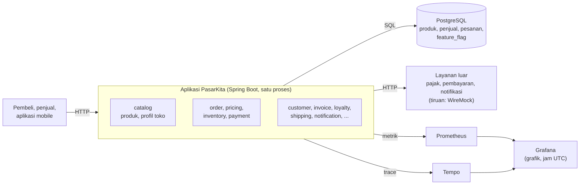
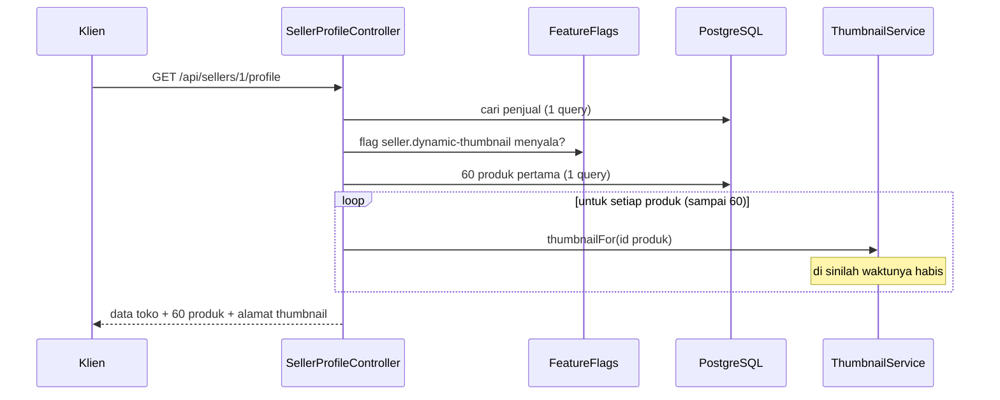

# PasarKitaGood: belajar backend dan database lewat tiket

Di tempat kerja, sebagian besar pekerjaan backend datang sebagai **tiket**: laporan bahwa ada yang salah, ditulis oleh
orang yang merasakan akibatnya, bukan oleh orang yang tahu penyebabnya. Repo ini mengajarkan backend dan database dengan
cara itu. Dua tiket nyata dikerjakan sampai tuntas, lengkap dengan Issue, pull request, tinjauan rekan, dan bukti
pengukuran, supaya kamu bisa melihat **bagaimana pekerjaan itu dilakukan dengan baik**.

Repo ini dibuat dari repo induk [PasarKita](https://github.com/joelianmin/PasarKita), tempat mahasiswa mengerjakan tiket
mereka sendiri. PasarKitaGood bukan tugas; ia teladan untuk dibandingkan dengan pekerjaanmu.

**Yang nyata:** kode, perintah, Issue, PR, commit, dan semua angka, diukur pada 20 dan 21 November 2026 di komputer uji
Intel Core i5-5250U (2 core, 4 thread), RAM 8 GB, macOS 12, tanpa Docker, data skala S. **Peran:** satu akun GitHub
memerankan tiga anggota tim, **Ayu** (pemilik tiket), **Bimo** dan **Citra** (peninjau). Tinjauan ditulis sebagai
komentar bertanda peran, karena GitHub tidak mengizinkan penulis PR menyetujui PR-nya sendiri. Di tim sungguhan, setiap
peninjau memakai akunnya sendiri dan menekan Approve.

## PasarKita dalam satu menit

PasarKita adalah layanan backend sebuah toko daring: penjual membuka toko, pembeli mencari produk, mengisi keranjang,
membayar, dan menerima kiriman. Layanan ini satu aplikasi **Spring Boot** yang dibagi menjadi modul (*modulith*), dengan
satu database **PostgreSQL**.

| Bagian | Fungsinya dalam pekerjaan sehari-hari |
| --- | --- |
| Aplikasi dan modulnya | Tempat kode diubah. Tiket di repo ini menyentuh modul `catalog` |
| PostgreSQL | Tempat data. `pg_stat_statements` memperlihatkan query apa yang berjalan dan berapa lama |
| Prometheus dan Grafana | Grafik waktu respons dan CPU per menit, untuk melihat **kapan** sesuatu berubah |
| Tempo | Jejak satu request melewati bagian-bagian aplikasi |
| k6 | Alat untuk mengirim beban tetap (misalnya 2 request per detik) dan mengukur waktu respons |

Halaman yang dibahas di repo ini adalah **profil toko** (`GET /api/sellers/{id}/profile`). Jalurnya:

## Dua jenis tiket: diagnosis lalu perbaikan

Bayangkan dokter. Pasien datang dengan keluhan "dada saya sakit". Dokter tidak langsung memberi obat: ia memeriksa dulu
(**diagnosis**). Setelah penyebabnya jelas, ia menulis resep yang memperhatikan alergi dan kondisi pasien (**perbaikan
dengan batasan**). Tim backend bekerja dengan urutan yang sama.

| | Tiket diagnosis: **#4821** | Tiket perbaikan: **PK-200** |
| --- | --- | --- |
| Datang dari | Tim Dukungan Penjual, meneruskan keluhan penjual | Account Manager, setelah diagnosis ada, karena Toko Raksasa dan toko lain mengeluh |
| Pertanyaannya | **Apa** yang terjadi, di lapisan mana, dan **mengapa**? | **Bagaimana** memperbaikinya tanpa melanggar keputusan dan batasan yang berlaku? |
| Yang tidak boleh | Mengubah kode. Memperbaiki sebelum mengerti sering menutupi gejala | Memilih solusi tanpa memeriksa batasan: keputusan produk, kontrak dengan CDN, anggaran |
| Hasilnya | Laporan dengan bukti dari beberapa sumber dan hipotesis bertanda "belum terbukti" | Perubahan kode, test, pengukuran ulang, bukti, dan komentar penutupan |
| Di repo ini | Issue #2, PR #3, `LAPORAN-4821.md` | Issue #5, PR #6, `JURNAL.md` |

Kenapa dipisah, tidak sekaligus? Di tempat kerja, diagnosis sering dikerjakan cepat oleh orang yang sedang bertugas,
sedangkan perbaikan butuh keputusan dari pihak lain. Di sini, Product menolak fitur dimatikan, tim CDN melarang alamat
gambar berubah, dan Tim Platform tidak punya anggaran server. Perbaikan yang baik baru bisa dipilih setelah penyebab
diketahui **dan** batasan dibaca.

## Cara kerja di dunia kerja

| Tahap | Yang dilakukan tim | Label Issue | Contoh di repo ini |
| --- | --- | --- | --- |
| 1. Laporan masuk | Seseorang menulis gejala, biasanya tanpa penyebab | | Tiket #4821, tiket PK-200 |
| 2. Triage | Pemilik tiket menulis ulang tiket dengan kata-katanya sendiri, menentukan ukuran dan penanggung jawab | `triage` | Issue #2, Issue #5 |
| 3. Rencana | Pemilik menulis tujuan, risiko, dan rencana B sebelum mulai | | Issue #1 |
| 4. Diagnosis | Mengukur patokan, mengumpulkan bukti dari beberapa sumber, menulis dugaan dan mengujinya | `diagnosis` | `LAPORAN-4821.md`, `JURNAL.md` |
| 5. Perubahan | Membuka PR, menulis test lebih dulu, mengubah kode sekecil mungkin | | PR #6 |
| 6. Tinjauan rekan | Dua rekan memeriksa hal yang berbeda dan menyebut apa yang mereka periksa | `review` | PR #3, PR #6 |
| 7. Penutupan | Menulis akar masalah, batasan, alternatif, hasil, bukti, dan tindak lanjut untuk semua pemangku kepentingan | `selesai` | Penutupan Issue #2 dan #5 |

Prinsip yang dipakai sepanjang jalan:

- **Tulis dulu, baru bertindak.** Rencana, prediksi, dan alasan ditulis sebelum mengukur atau mengubah kode, supaya hasil
  bisa membuktikan bahwa kita salah.
- **Bukti, bukan opini.** Setiap klaim punya angka, satuan, jam, dan sumber yang bisa diperiksa orang lain.
- **Perubahan kecil yang bisa dibatalkan.** PK-200 diperbaiki dengan mengubah satu berkas.
- **Jaga perilaku yang sudah dijanjikan.** Respons, alamat, dan kontrak dengan tim lain tidak boleh berubah tanpa
  kesepakatan; test membuktikannya.
- **Komunikasi terbuka.** Rencana yang berubah, dugaan yang gugur, dan hal yang belum terjelaskan dicatat, bukan
  disembunyikan.

Yang disederhanakan di repo ini: tidak ada server produksi (semua diukur di komputer uji), tidak ada rilis sungguhan, dan
satu akun memerankan tiga orang.

## Urutan membaca

Diurutkan menurut waktu, dari tiket dan dokumen konteks yang sudah ada sampai tiket ditutup. Baris 1 sampai 9: #4821 dan PK-200 (20–21 Nov). Baris 10 sampai 12: PK-300 (27 Nov).

| # | Kapan | Apa | Tempat | Yang patut ditiru / diperhatikan |
| --- | --- | --- | --- | --- |
| 1 | 1 Okt 2026 | Paket konteks PK-200: anggaran infrastruktur (Tim Platform) | [`labs/pk-200/konteks/03-anggaran-infrastruktur.md`](labs/pk-200/konteks/03-anggaran-infrastruktur.md) | Batasan keras: tidak ada server tambahan |
| 2 | 12 Nov 2026 | Paket konteks PK-200: keputusan produk (Bayu) | [`labs/pk-200/konteks/01-keputusan-produk-thumbnail.md`](labs/pk-200/konteks/01-keputusan-produk-thumbnail.md) | Batasan keras: flag tetap menyala, URL thumbnail tidak boleh berubah |
| 3 | 13 Nov 2026 | Paket konteks PK-200: thread CDN (Rudi, Tomi, Bayu) | [`labs/pk-200/konteks/02-thread-cdn.md`](labs/pk-200/konteks/02-thread-cdn.md) | Alasan di balik batasan URL; informasi samping 200 x 200 yang menjadi kunci perbaikan |
| 4 | Jumat 20 Nov, dibaca 19.12 (jam laporan 19.28) | Tiket #4821 (Tim Dukungan Penjual) | [`labs/latihan/TIKET.md`](labs/latihan/TIKET.md) | Gejala dari sudut pandang pengguna, bukan penyebab |
| 5 | Jumat 20 Nov, 19.12 | Rencana sesi | [Issue #1](https://github.com/joelianmin/PasarKitaGood/issues/1) | Risiko dengan tanda dan rencana B; komentar Cek, Perubahan (sesi terbelah semalam), dan Refleksi |
| 6 | Jumat 20 Nov, 19.12 sampai 19.44 | Diagnosis #4821 | [Issue #2](https://github.com/joelianmin/PasarKitaGood/issues/2), [PR #3](https://github.com/joelianmin/PasarKitaGood/pull/3), [`LAPORAN-4821.md`](labs/latihan/LAPORAN-4821.md) | Sepuluh bukti dengan jam WIB/UTC; `RATE=1` saat komputer uji kewalahan; dugaan yang gugur ditulis; tinjauan menemukan satuan CPU yang bercampur |
| 7 | Sabtu 21 Nov, 07.30 | Mengambil pembaruan repo induk | [PR #4](https://github.com/joelianmin/PasarKitaGood/pull/4) | Pembaruan masuk lewat PR, tanpa menyentuh pekerjaan tim |
| 8 | Sabtu 21 Nov, 07.31 | Tiket PK-200 (Maya, Eko, Dimas) | [`labs/pk-200/LAB.md`](labs/pk-200/LAB.md) | Dua usul di tiket adalah solusi titipan; nilai terhadap paket konteks (baris 1 sampai 3) |
| 9 | Sabtu 21 Nov, 07.31 sampai 07.59 | Perbaikan PK-200 | [Issue #5](https://github.com/joelianmin/PasarKitaGood/issues/5), [PR #6](https://github.com/joelianmin/PasarKitaGood/pull/6), [`JURNAL.md`](labs/pk-200/JURNAL.md) | Prediksi sebelum mengukur; batasan dari paket konteks; prediksi yang salah diuji (255 warna); test patokan ditulis sebelum kode diubah; `task evidence` dari commit bersih; komentar penutupan lengkap |
| 10 | 1 Jan, 2 Nov, 22 Nov 2026 | Paket konteks PK-300: aturan pajak, thread tim pajak, rekap pajak | [`labs/pk-300/konteks/`](labs/pk-300/konteks/) | Batasan keras: tarif tidak boleh ditebak, transaksi tanpa tarif tidak boleh selesai, koreksi data lama oleh Keuangan |
| 11 | Jumat 27 Nov, 09.53 | Mengambil pembaruan repo induk (tiket 27 Nov – 3 Des) | [PR #19](https://github.com/joelianmin/PasarKitaGood/pull/19) | Peninjau mengoreksi komentarnya sendiri secara terbuka setelah salah membaca hasil pemeriksaan |
| 12 | Jumat 27 Nov, 09.54 sampai 10.32 | Perbaikan PK-300 (Lestari, Bayu, Pak Hendra) | [Issue #20](https://github.com/joelianmin/PasarKitaGood/issues/20), [Issue #21](https://github.com/joelianmin/PasarKitaGood/issues/21), [PR #22](https://github.com/joelianmin/PasarKitaGood/pull/22), [`JURNAL.md`](labs/pk-300/JURNAL.md) | Bug kebenaran data: test yang **gagal pada kode lama** lebih dulu; prediksi yang salah (keranjang hilang) diuji sebelum menulis kode; hasil dicek di database, bukan hanya dari respons; query data lama tanpa mengubah data |

Teks tiket #4821 sudah ada di repo sejak awal; jam laporannya (19.28) adalah jam yang dicetak `task latihan:mulai`. Tiket PK-200
di dalam cerita bertanggal Senin; di repo ini ia dibaca Sabtu 07.31 setelah pembaruan repo induk diambil.

Urutan waktu lengkap, termasuk apa yang dipikirkan, dipertimbangkan, dan dipelajari setiap pemangku kepentingan (anggota
tim, pelapor, Product, CDN, Platform): [`KRONOLOGI.md`](KRONOLOGI.md).

## Hasil singkat

| PK-200, 2 req/detik, flag tetap menyala | Flag mati (patokan) | Sebelum perbaikan | Sesudah perbaikan |
| --- | --- | --- | --- |
| Waktu respons toko terbesar (p95) | 22 ms | sekitar 57 detik, 40,7% request gagal | **39 ms**, 0 gagal |
| Isi respons | | | Sama persis dengan sebelum perbaikan |

## Yang patut ditiru

| Kebiasaan | Di mana |
| --- | --- |
| Risiko ditulis dengan tanda dan rencana B, lalu rencana diubah secara terbuka saat keadaan berubah | Issue #1 |
| Patokan diukur sebelum masalah dinyalakan, dan dugaan yang gugur tetap ditulis | Issue #2, `LAPORAN-4821.md` |
| Usul di tiket dinilai terhadap dokumen konteks, bukan pendapat | `JURNAL.md` bagian 2 dan 3 |
| Prediksi yang terasa pasti tetap diuji, dengan cakupan penuh | `BandingThumbnail.java`, 255 warna |
| Test patokan ditulis sebelum kode diubah | Commit `48cab1c` lalu `0f51d95` |
| Peninjau memeriksa hal yang berbeda dan menyebut apa yang mereka periksa | PR #3, PR #6 |
| Hal yang belum terjelaskan masuk tindak lanjut | Penutupan Issue #5 |

## Ingin menjalankan sendiri?

Cara memasang alat, menjalankan aplikasi, dan mengulang pengukuran contoh ini ada di
[`MENJALANKAN-SENDIRI.md`](MENJALANKAN-SENDIRI.md).

Tiket berikutnya ditambahkan ke repo ini setelah tenggat pengerjaan mahasiswa lewat.

