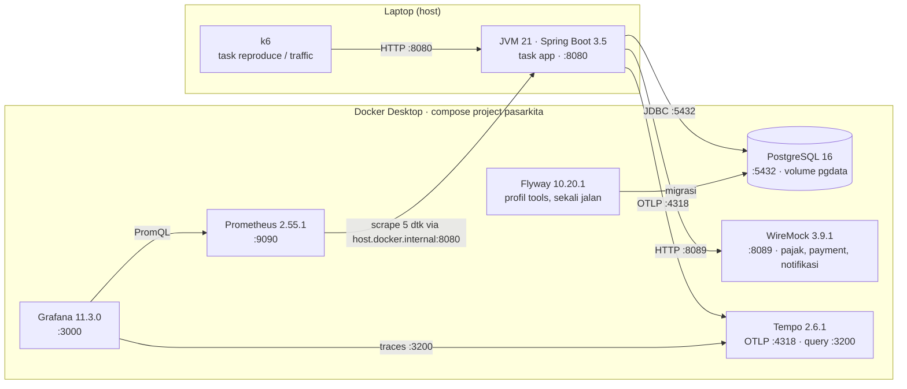

# PasarKitaGood: contoh ideal pengerjaan tiket

Repo ini dibuat dari templat [PasarKita](https://github.com/joelianmin/PasarKita) dan dikerjakan seperti repo kelompok,
dari rencana sampai tiket ditutup. **Kode, perintah, dan semua angka nyata**: diukur pada 20 dan 21 November 2026 di
laptop Intel Core i5-5250U (2 core, 4 thread), RAM 8 GB, macOS 12, tanpa Docker, data skala S.

**Peran contoh.** Satu akun GitHub memerankan tiga anggota kelompok: **Ayu** (pemilik tiket), **Bimo** dan **Citra**
(peninjau). Tinjauan ditulis sebagai komentar bertanda peran, karena GitHub tidak mengizinkan penulis PR menyetujui
PR-nya sendiri. Di kelompokmu, peninjau memakai akunnya sendiri dan menekan Approve.

## Urutan membaca

Diurutkan menurut waktu, dari tiket dan dokumen konteks yang sudah ada sampai tiket ditutup.

| # | Kapan | Apa | Tempat | Yang patut ditiru / diperhatikan |
| --- | --- | --- | --- | --- |
| 1 | 1 Okt 2026 | Paket konteks PK-200: anggaran infrastruktur (Tim Platform) | [`labs/pk-200/konteks/03-anggaran-infrastruktur.md`](labs/pk-200/konteks/03-anggaran-infrastruktur.md) | Batasan keras: tidak ada server tambahan |
| 2 | 12 Nov 2026 | Paket konteks PK-200: keputusan produk (Bayu) | [`labs/pk-200/konteks/01-keputusan-produk-thumbnail.md`](labs/pk-200/konteks/01-keputusan-produk-thumbnail.md) | Batasan keras: flag tetap menyala, URL thumbnail tidak boleh berubah |
| 3 | 13 Nov 2026 | Paket konteks PK-200: thread CDN (Rudi, Tomi, Bayu) | [`labs/pk-200/konteks/02-thread-cdn.md`](labs/pk-200/konteks/02-thread-cdn.md) | Alasan di balik batasan URL; informasi samping 200 x 200 yang menjadi kunci perbaikan |
| 4 | Jumat 20 Nov, dibaca 19.12 (jam laporan 19.28) | Tiket #4821 (Tim Dukungan Penjual) | [`labs/latihan/TIKET.md`](labs/latihan/TIKET.md) | Gejala dari sudut pandang pengguna, bukan penyebab |
| 5 | Jumat 20 Nov, 19.12 | Rencana sesi | [Issue #1](https://github.com/joelianmin/PasarKitaGood/issues/1) | Risiko dengan tanda dan rencana B; komentar Cek, Perubahan (sesi terbelah semalam), dan Refleksi |
| 6 | Jumat 20 Nov, 19.12 sampai 19.44 | Diagnosis #4821 (latihan) | [Issue #2](https://github.com/joelianmin/PasarKitaGood/issues/2), [PR #3](https://github.com/joelianmin/PasarKitaGood/pull/3), [`LAPORAN-4821.md`](labs/latihan/LAPORAN-4821.md) | Sepuluh bukti dengan jam WIB/UTC; `RATE=1` saat laptop jenuh; dugaan yang gugur ditulis; tinjauan menemukan satuan CPU yang bercampur |
| 7 | Sabtu 21 Nov, 07.30 | Mengambil pembaruan templat | [PR #4](https://github.com/joelianmin/PasarKitaGood/pull/4) | Mengikuti `docs/PANDUAN-PEMBARUAN.md` tanpa menyentuh berkas kelompok |
| 8 | Sabtu 21 Nov, 07.31 | Tiket PK-200 (Maya, Eko, Dimas) | [`labs/pk-200/LAB.md`](labs/pk-200/LAB.md) | Dua usul di tiket adalah solusi titipan; nilai terhadap paket konteks (baris 1 sampai 3) |
| 9 | Sabtu 21 Nov, 07.31 sampai 07.59 | Perbaikan PK-200 | [Issue #5](https://github.com/joelianmin/PasarKitaGood/issues/5), [PR #6](https://github.com/joelianmin/PasarKitaGood/pull/6), [`JURNAL.md`](labs/pk-200/JURNAL.md) | Prediksi sebelum mengukur; batasan dari paket konteks; prediksi yang salah diuji (255 warna); test patokan ditulis sebelum kode diubah; `task evidence` dari commit bersih; komentar penutupan lengkap |

Teks tiket #4821 sudah ada di repo sejak awal; jam laporannya (19.28) adalah jam yang dicetak `task latihan:mulai`. Tiket PK-200
di dalam cerita bertanggal Senin; di repo ini ia dibaca Sabtu 07.31 setelah pembaruan templat diambil.

Urutan waktu lengkap, termasuk apa yang dipikirkan, dipertimbangkan, dan dipelajari setiap pemangku kepentingan (anggota
kelompok, pelapor, Product, CDN, Platform): [`KRONOLOGI.md`](KRONOLOGI.md).

Label tiket bergerak `triage` → `diagnosis` → `review` → `selesai`. Tiket berikutnya ditambahkan setelah tenggatnya lewat.

---

# PasarKita – base code minggu 1

Aplikasi modulith Spring Boot untuk lab backend. Versi ini disiapkan untuk minggu 1
(orientasi dan alat ukur). Masalah untuk lab berikutnya ditambahkan bertahap.

## Prasyarat

JDK 21, Docker Desktop (backend WSL2 di Windows), Git, k6, dan Task (go-task).
Di Windows:

```powershell
winget install EclipseAdoptium.Temurin.21.JDK
winget install Git.Git
winget install Task.Task
```

Docker Desktop dan k6 dipasang dari installer resmi masing-masing.

## Mulai cepat

```powershell
task doctor                          # periksa lingkungan
task up PROFILE=core,observability   # PostgreSQL, Prometheus, Grafana, Tempo, WireMock
task seed SCALE=S                    # migrasi skema + data contoh (skala M untuk Lab 0)
task app                             # aplikasi di http://localhost:8080
task test                            # test fungsional (butuh Docker untuk Testcontainers)
```

Ketik `task --list` untuk semua perintah.

Tidak bisa memakai Docker (misalnya macOS 12)? Lihat [`infra/native/README.md`](infra/native/README.md)
untuk menjalankan semua komponen pendukung tanpa Docker (`task native:up`).

Baru di proyek ini? Mulai dari [`docs/MATERI-DASAR.md`](docs/MATERI-DASAR.md): daftar isi
dan jalur belajar untuk sembilan bagian materi (fondasi, lingkungan kerja, memahami sistem,
mengukur, mutu dan desain, diagnosa dan latihan, menyerahkan hasil, contoh pengerjaan tiket,
dari diagnosis ke perbaikan) beserta referensi.

| Alamat | Isi |
| --- | --- |
| http://localhost:8080/actuator/health | Status aplikasi |
| http://localhost:3000 | Grafana, dashboard "PasarKita Overview" di folder PasarKita |
| http://localhost:9090 | Prometheus |
| http://localhost:8089 | WireMock: API pajak, payment gateway, dan notifikasi tiruan |

Akun contoh: `user1@pasarkita.test` sampai `userN@pasarkita.test`, password `rahasia123`.
Endpoint keranjang dan checkout memakai header `X-Customer-Id`.

Petunjuk lab ada di [`labs/README.md`](labs/README.md). Repo kelompokmu tidak berubah sendiri saat templat ini
diperbarui; cara mengambil pembaruan ada di [`docs/PANDUAN-PEMBARUAN.md`](docs/PANDUAN-PEMBARUAN.md).

## Modul

catalog, customer, order, pricing, inventory, payment, invoice, loyalty, notification,
shipping, booking, reporting, jobs, files, audit. Lihat `task modules` untuk verifikasi
struktur dan dokumentasi yang dihasilkan Spring Modulith.

## Deployment

Diagram lengkap, tabel port, dan varian tanpa Docker ada di [`docs/DEPLOYMENT.md`](docs/DEPLOYMENT.md).
Semua komponen berjalan di satu laptop. Aplikasi dan k6 berjalan langsung di host,
infrastruktur pendukung berjalan di Docker Compose.



Profil compose: `core` (PostgreSQL, WireMock, Prometheus, Grafana), `observability` (Tempo),
`tools` (Flyway). Aplikasi tidak dikemas dalam container: Prometheus menariknya lewat
`host.docker.internal`. Satu WireMock menggantikan tiga layanan luar, dibedakan oleh path.
Data bertahan di volume `pgdata` sampai `task reset`.

## Teknologi dan alat

**Library aplikasi** (Spring Boot 3.5.0, Spring Modulith 1.4.0)

| Kelompok | Library |
| --- | --- |
| Web dan data | `spring-boot-starter-web`, `-data-jpa`, `-validation`, PostgreSQL JDBC |
| Keamanan | `spring-security-crypto` (BCrypt) |
| Migrasi | `flyway-core`, `flyway-database-postgresql` |
| Modul | `spring-modulith-starter-core`, `spring-modulith-observability` |
| Observability | `spring-boot-starter-actuator`, `micrometer-registry-prometheus`, `micrometer-tracing-bridge-otel`, `opentelemetry-exporter-otlp` |
| Test | `spring-boot-starter-test`, Testcontainers (`junit-jupiter`, `postgresql`), `spring-modulith-starter-test`, `spring-modulith-docs` |

**Infrastruktur (image Docker):** `postgres:16`, `flyway/flyway:10.20.1`,
`wiremock/wiremock:3.9.1`, `prom/prometheus:v2.55.1`, `grafana/grafana:11.3.0`,
`grafana/tempo:2.6.1`.

**Alat di mesin pengembang:** JDK 21, Docker Desktop, Task (go-task), k6, Git, dan Maven
Wrapper. Skrip bantu `tools/Doctor.java` (cek lingkungan) dan `tools/Evidence.java`
(file bukti dengan hash SHA-256) dijalankan langsung oleh JDK.

## Uji beban dengan k6

| Script | Tujuan | Laju |
| --- | --- | --- |
| `labs/0/reproduce.k6.js` | Baseline 8 endpoint (Lab 0) | 31 iterasi/detik, 3 menit |
| `labs/latihan/profile.k6.js` | Beban ke halaman profil penjual | 2 req/detik (ubah dengan `RATE=n`), 3 menit |
| `traffic/simulator.k6.js` | Traffic latar belakang | 7 iterasi/detik, 8 jam |

Semuanya memakai model terbuka (`constant-arrival-rate`), jadi laju request tetap walau
server melambat. Status 402 dan 409 pada checkout dianggap normal. Lihat `labs/0/LAB.md`
untuk catatan penggunaan.

## Catatan Windows

- Simpan repo di path pendek, misalnya `C:\dev\pasarkita`, dan jalankan
  `git config --global core.longpaths true`.
- Memori Docker diatur lewat `%UserProfile%\.wslconfig`, lalu `wsl --shutdown`.
- Gunakan `curl.exe`, bukan `curl`, di Windows PowerShell 5.1.
- Kecualikan folder repo dan `%UserProfile%\.m2` dari pemindaian Microsoft Defender.
